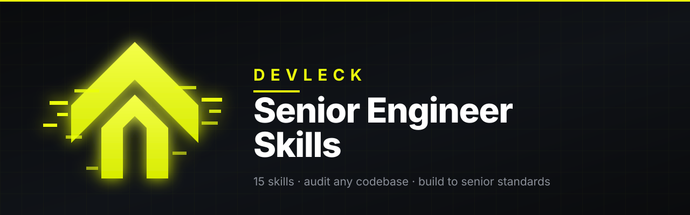

<div align="center">



# Senior Engineer Skills

**Convierte Claude Code en un equipo de ingeniería senior.**

Veinte skills que auditan un proyecto existente en quince dominios, responden a
incidentes de seguridad, prueban sistemas con autorización, o construyen uno nuevo con
el estándar que superaría una *due diligence*, un test de penetración y la revisión de
una autoridad de protección de datos.

[](https://docs.anthropic.com/en/docs/agents-and-tools/agent-skills/overview)
[](#las-skills)
[](#comandos)
[](#subagentes)
[](LICENSE)

**[English](README.md)** · **[Español](README.es.md)**

<sub>Creado por **[Devleck](https://github.com/Kin9Zeus)** — Aleck Martinez, Founder &amp; CEO</sub>

</div>

---

## Qué es esto

La mayoría de la asistencia de IA produce código que funciona. Esto hace que produzca
código que **sobrevive**: a una revisión de seguridad, a un incidente real, a un pico
de escala, a la pregunta de un regulador y al ingeniero que lo herede dentro de dos
años.

Instala veinte skills especializadas que Claude carga automáticamente cuando el
trabajo lo requiere, o que puedes invocar por nombre.

```
Tú: "revisa mi proyecto antes de lanzar"

Claude carga senior-engineer → project-audit → y despacha las pasadas por dominio.

→ Estado real: Next.js 15, Postgres 16, Stripe, 4 encargados, 31 tests, CI sin bloqueo
→ P0: cualquier usuario autenticado puede leer las facturas de otro (api/invoices/[id]:24)
→ P0: STRIPE_SECRET_KEY presente en el historial de git desde el commit 8f14e45
→ P1: copias de seguridad configuradas, nunca restauradas — capacidad sin verificar
→ P1: la política de privacidad omite PostHog e Intercom, que sí reciben datos personales
→ 58/100 — En riesgo. Más débiles: Privacidad 2/10, Observabilidad 3/10, Testing 4/10
→ Plan de remediación: 3 bloqueantes, ~2 días hasta un estado lanzable
```

Cada hallazgo incluye una ubicación, una consecuencia concreta, la corrección y una
forma de **verificar** la corrección. Un hallazgo sin paso de verificación es una
opinión.

---

## Instalación

> [!TIP]
> **La vía más rápida — cualquier sistema, 30 segundos.** Dentro de Claude Code,
> ejecuta estas dos líneas:
>
> ```
> /plugin marketplace add Kin9Zeus/senior-engineer-skills
> /plugin install senior-engineer-skills@senior-engineer-skills
> ```
>
> Reinicia Claude Code, escribe `/snr-` — **aparecen catorce comandos**. Listo.

¿No usas Claude Code, la quieres en un solo proyecto, o prefieres leer antes lo que se
copia? Elige tu sistema:

<table>
<tr>
<th width="33%">🪟 Windows</th>
<th width="33%">🍎 macOS</th>
<th width="33%">🐧 Linux · WSL · Git Bash</th>
</tr>
<tr>
<td>

PowerShell 5.1+:

```powershell
git clone https://github.com/Kin9Zeus/senior-engineer-skills.git
cd senior-engineer-skills
./install.ps1
```

</td>
<td>

Terminal:

```bash
git clone https://github.com/Kin9Zeus/senior-engineer-skills.git
cd senior-engineer-skills
./install.sh
```

</td>
<td>

Cualquier shell con bash:

```bash
git clone https://github.com/Kin9Zeus/senior-engineer-skills.git
cd senior-engineer-skills
./install.sh
```

</td>
</tr>
</table>

El instalador **muestra exactamente lo que va a hacer y pregunta antes de sobrescribir
nada**. Detecta automáticamente Claude Code, Cursor, Codex, OpenCode y Antigravity, y
copia `skills/`, `commands/` y `agents/` al directorio de ese agente.

> [!IMPORTANT]
> A propósito **no** ofrecemos un `curl … | sh`. Un conjunto de seguridad no debería
> pedirte ejecutar un script que no has leído. Clona, echa un vistazo a `install.sh` /
> `install.ps1` (son cortos) y ejecuta.

### Opciones del instalador

| Quieres… | macOS · Linux · WSL | Windows (PowerShell) |
|---|---|---|
| **Previsualizar** sin cambiar nada | `./install.sh --dry-run` | `./install.ps1 -DryRun` |
| Instalar **solo en un proyecto** (`./.claude/`) | `./install.sh --project` | `./install.ps1 -Project` |
| Elegir un **agente concreto** | `./install.sh --agent cursor` | `./install.ps1 -Agent cursor` |
| Solo skills — **sin comandos ni agentes** | `./install.sh --skills-only` | `./install.ps1 -SkillsOnly` |
| **Sin preguntas** (CI, scripts) | `./install.sh --yes` | `./install.ps1 -Yes` |
| **Desinstalar** | `./install.sh --uninstall` | `./install.ps1 -Uninstall` |

Agentes: `claude` · `cursor` · `codex` · `opencode` · `antigravity`. Las opciones se
combinan, p. ej. `./install.sh --project --dry-run`.

### Otras vías

<details>
<summary><b>Cualquier agente — un comando con Node (Windows, macOS, Linux)</b></summary>

Funciona con Claude Code, Cursor, Codex, Windsurf, Copilot, Antigravity y
[más de 40 agentes](https://github.com/vercel-labs/skills#supported-agents):

```bash
npx skills add https://github.com/Kin9Zeus/senior-engineer-skills
```

Esto instala las skills. Los comandos y subagentes son funciones de Claude Code; usa el
plugin o `install.sh` / `install.ps1` para obtenerlos también.
</details>

<details>
<summary><b>Que lo haga Claude</b></summary>

Pega la URL del repositorio en Claude Code y pídele:

> Instala este plugin globalmente: https://github.com/Kin9Zeus/senior-engineer-skills
</details>

<details>
<summary><b>Sin Git instalado (Windows)</b></summary>

Descarga el ZIP desde **Code → Download ZIP** en el repositorio, extráelo y, en
PowerShell desde la carpeta extraída:

```powershell
Get-ChildItem -Recurse | Unblock-File     # quita la marca de "descargado de internet"
./install.ps1
```
</details>

<details>
<summary><b>Dónde se copian los archivos</b></summary>

| Agente | Directorio de skills (macOS · Linux) | Windows |
|---|---|---|
| Claude Code | `~/.claude/skills/` | `%USERPROFILE%\.claude\skills\` |
| Cursor | `~/.cursor/skills/` | `%USERPROFILE%\.cursor\skills\` |
| OpenAI Codex | `~/.codex/skills/` | `%USERPROFILE%\.codex\skills\` |
| OpenCode | `~/.config/opencode/skills/` | `%USERPROFILE%\.config\opencode\skills\` |
| Google Antigravity | `~/.gemini/antigravity/skills/` | `%USERPROFILE%\.gemini\antigravity\skills\` |

Los comandos y agentes van a los directorios hermanos `commands/` y `agents/`. Con
`--project` / `-Project`, todo va a `.claude/` en el directorio actual — súbelo al
repositorio para que todo tu equipo tenga el conjunto.
</details>

### Comprueba que funcionó

1. **Reinicia** tu agente.
2. Escribe `/snr-` — deberías ver **14 comandos** (`/snr-audit`, `/snr-incident`,
   `/snr-pentest`, …).
3. Pide algo que deba activar una skill: *«revisa mi proyecto antes de lanzar»* → se
   cargan `senior-engineer` y `project-audit`.

<details>
<summary><b>¿Algo no va bien?</b></summary>

| Síntoma | Solución |
|---|---|
| `/snr-` no muestra nada | Reinicia el agente por completo; con el plugin, confirma con `/plugin` |
| `Permission denied` al ejecutar `install.sh` | `chmod +x install.sh`, o ejecuta `bash install.sh` |
| PowerShell: *«la ejecución de scripts está deshabilitada»* | Solo para esa ventana: `Set-ExecutionPolicy -Scope Process -ExecutionPolicy Bypass` y luego `./install.ps1` |
| PowerShell: *«no está firmado digitalmente»* tras descargar el ZIP | `Get-ChildItem -Recurse \| Unblock-File` |
| Detecta el agente equivocado | Indícalo: `--agent cursor` / `-Agent cursor` |
| No sabes qué va a tocar | Primero `--dry-run` / `-DryRun` — no cambia nada |
</details>

### Actualizar y desinstalar

```bash
git pull && ./install.sh          # Windows: git pull; ./install.ps1
```

Con el plugin: actualiza el marketplace desde el menú `/plugin` y reinstala. Para quitar todo:
`/plugin uninstall senior-engineer-skills`, o `./install.sh --uninstall` /
`./install.ps1 -Uninstall`.

---

## Cómo se activa

De las dos formas, siempre.

**Automáticamente.** Cada skill declara las situaciones a las que pertenece. Claude
carga `security-hardening` cuando tocas una ruta de autenticación,
`database-engineering` cuando escribes una migración y `privacy-compliance` cuando un
formulario empieza a recoger un correo electrónico — sin que se lo pidas.

**Bajo demanda.** Nombra una skill o usa un comando:

```
"usa la skill project-audit en este repo"
"haz una pasada de security-hardening sobre la API"
/snr-audit --deep
```

---

## Respuesta a incidentes y hacking ético

Añadido en la 1.1.0, tras dos incidentes en la misma semana de octubre de 2026:

- **Railway** comunicó (21 oct) que un tercero no autorizado pudo acceder a los
  sistemas que almacenan las variables de entorno de los clientes — algunas
  posiblemente descifradas — y pidió a todos rotar sus variables y credenciales de
  registro. [Comunicado de Railway](https://blog.railway.com/p/security-disclosure-wednesday-october-21st).
- **PHP** publicó correcciones de emergencia (21 oct) para dos fallos críticos de
  ejecución remota de código sin autenticación en el propio intérprete,
  CVE-2026-109618 y CVE-2026-109619 («php2shell»), corregidos en 8.5.12, 8.4.27,
  8.3.36 y 8.2.35. [Alerta de CISA](https://www.cisa.gov/news-events/alerts/2026/10/21/critical-vulnerabilities-php-require-immediate-patching).

> Los hechos de incidentes en las skills están **fechados a 2026-10-23** y enlazan
> sus fuentes primarias. Relee las páginas actuales del proveedor y del proyecto PHP
> antes de actuar.

Qué hace ahora el conjunto al respecto:

| Necesitas… | Usa | Idea central |
|---|---|---|
| Responder a una brecha, una clave filtrada, un CVE explotado, un servidor sospechoso | `/snr-incident` · `security-incident-response` | Revocar antes de investigar, investigar antes de limpiar; rotar **primero en el emisor** y demostrar que el valor viejo está muerto |
| Rotar todos los secretos rápido | `/snr-rotate` | Inventario solo de nombres → orden por radio de impacto → verificar con un `401` |
| Revisar y corregir PHP | `/snr-php` · `php-hardening` | Inventariar todo PHP, verificar el build **en ejecución**, mitigaciones temporales, evaluación de compromiso, base de FPM/ini |
| Que una variable de entorno robada no valga nada | `/snr-cloud` · `cloud-security` | La escalera de secretos: acotado, restringido por red, con tope de gasto, de vida corta, detectado al primer uso |
| Atacar tu propio sistema, con seguridad | `/snr-pentest` · `pentest-methodology` | **Autorización escrita + archivo de alcance + `scope-guard`** antes de enviar un solo paquete; prueba no destructiva; corrección, test de regresión y reprueba |
| Asegurar funciones de IA y agentes | `/snr-ai-security` · `ai-security` | Romper la combinación datos privados / contenido no confiable / canal de salida; mínima agencia; claves de proveedor acotadas y con tope |
| Modelar amenazas | `/snr-threatmodel` | STRIDE, un control y un test por amenaza |

**Salvaguardas.** Solo defensivo y autorizado: sin exploits armados, sin malware, sin
denegación de servicio, sin post-explotación, sin probar a terceros. Se rechaza el
test activo sin un archivo de alcance cuya autorización no haya caducado.

---

## Las skills

<table>
<tr><th>Skill</th><th>Qué hace</th><th>Se carga cuando</th></tr>

<tr><td><b>senior-engineer</b></td>
<td>El enrutador y el estándar. Establece el estado real antes de opinar, elige el modo, delega en el especialista correcto y hace cumplir el mínimo innegociable.</td>
<td>Cualquier trabajo de ingeniería no trivial</td></tr>

<tr><td><b>project-audit</b></td>
<td>Auditoría completa en 15 dominios → hallazgos priorizados + puntuación 0–100.</td>
<td>"revisa mi proyecto", "¿está listo para producción?"</td></tr>

<tr><td><b>project-blueprint</b></td>
<td>Arquitectura y andamiaje desde cero, en el orden que evita retrofits caros.</td>
<td>"constrúyeme un…", "empezar un proyecto nuevo"</td></tr>

<tr><td><b>security-hardening</b></td>
<td>OWASP Top 10, autorización a nivel de objeto, inyección, autenticación, CSP, secretos, cadena de suministro, modelado de amenazas.</td>
<td>Auth, pagos, subidas, dependencias, auditorías</td></tr>

<tr><td><b>database-engineering</b></td>
<td>Esquema, restricciones, índices, planes de consulta, N+1, migraciones, multi-tenancy, backups, simulacros de restauración, retención.</td>
<td>Cualquier trabajo de persistencia</td></tr>

<tr><td><b>api-contracts</b></td>
<td>Diseño REST/GraphQL, sobres de error, paginación, idempotencia, versionado, límites de tasa, webhooks, OpenAPI.</td>
<td>Cualquier endpoint o integración</td></tr>

<tr><td><b>devops-platform</b></td>
<td>CI/CD, IaC, contenedores, paridad de entornos, estrategias de despliegue, rollback, secretos, recuperación ante desastres, coste.</td>
<td>Pipelines, Docker, Terraform, despliegues</td></tr>

<tr><td><b>observability-slo</b></td>
<td>Logs estructurados, métricas, trazas, identificadores de correlación, SLO y presupuestos de error, alertas sobre síntomas, respuesta a incidentes.</td>
<td>"¿cómo sabemos si se rompe?"</td></tr>

<tr><td><b>testing-strategy</b></td>
<td>La pirámide, política de cobertura con sentido, tests de integración y de contrato, E2E, control de flakes, mutation testing.</td>
<td>Cualquier conversación sobre tests</td></tr>

<tr><td><b>performance-engineering</b></td>
<td>Core Web Vitals, tamaño del bundle, estrategia de renderizado, presupuestos de latencia, caché, profiling, pruebas de carga.</td>
<td>"va lento", planificación de escala</td></tr>

<tr><td><b>accessibility-audit</b></td>
<td>WCAG 2.2 AA — teclado, foco, semántica, contraste, formularios, patrones ARIA, movimiento reducido, pruebas con tecnología de asistencia real.</td>
<td>Cualquier trabajo de interfaz</td></tr>

<tr><td><b>web-presence-audit</b></td>
<td>SEO técnico, metadatos por página, datos estructurados, 404 personalizada, enlazado interno y la capa de confianza y conversión.</td>
<td>Cualquier sitio público</td></tr>

<tr><td><b>privacy-compliance</b></td>
<td>Inventario de datos desde el código, política de privacidad veraz, consentimiento que realmente bloquea, borrado y exportación automatizados.</td>
<td>Cualquier dato personal</td></tr>

<tr><td><b>release-readiness</b></td>
<td>La puerta de go/no-go → veredicto explícito de lanzar o no lanzar, con bloqueantes nombrados y un rollback ya ensayado.</td>
<td>Antes de cualquier lanzamiento</td></tr>

<tr><td><b>engineering-standards</b></td>
<td>Convenciones, flujo de git, práctica de PR y revisión, ADR, documentación, onboarding, DX, deuda técnica.</td>
<td>Prácticas de equipo, onboarding</td></tr>

<tr><td><b>security-incident-response</b></td>
<td>Clasificar, contener, rotar secretos primero en el emisor, cazar en los logs del proveedor, erradicar, recuperar, notificar. Incluye el caso fechado de Railway y la hoja de rotación.</td>
<td>"nos hackearon", "clave filtrada", "rota todos mis secretos"</td></tr>

<tr><td><b>php-hardening</b></td>
<td>Respuesta a php2shell (oct. 2026), inventario de PHP/SAPI, base de php.ini y FPM, mod_php → FPM, fallos de código PHP, Composer, WordPress, Laravel, Symfony.</td>
<td>Cualquier proyecto PHP; "vulnerabilidad de PHP"</td></tr>

<tr><td><b>pentest-methodology</b></td>
<td>Pruebas de penetración autorizadas: puerta de autorización, guardián de alcance, planes de prueba web/API/nube, prueba no destructiva, informe y reprueba.</td>
<td>"pentest", "hacking ético", "bug bounty"</td></tr>

<tr><td><b>cloud-security</b></td>
<td>Asumir que la plataforma será vulnerada: escalera de secretos, mínimo privilegio, OIDC, control de salida, contenedores, Kubernetes, escaneo de IaC, simulacros de rotación.</td>
<td>"¿es seguro Railway?", "¿dónde guardo los secretos?"</td></tr>

<tr><td><b>ai-security</b></td>
<td>Inyección de prompts, agencia excesiva, manejo de salidas, aislamiento en RAG, cadena de suministro de MCP y skills, protección de claves y gasto de proveedores de IA.</td>
<td>Funciones con LLM, agentes, servidores MCP</td></tr>
</table>

Cada skill es un `SKILL.md` conciso más archivos de referencia que se cargan bajo
demanda — **más de ochenta documentos** de checklists, rúbricas, patrones y
plantillas, para que Claude trabaje desde un estándar y no desde la memoria.

---

## Comandos

| Comando | Qué hace |
|---|---|
| `/snr-audit [ruta\|url] [--quick\|--deep] [--parallel]` | Auditoría completa → informe de hallazgos + puntuación. `--parallel` autoriza revisores concurrentes por dominio |
| `/snr-build <descripción>` | Arquitectura y andamiaje de un proyecto nuevo, en el orden correcto |
| `/snr-harden [alcance]` | Pasada de seguridad con correcciones y tests de regresión |
| `/snr-web <url>` | SEO, metadatos, datos estructurados, 404, enlaces internos, capa de confianza |
| `/snr-privacy [--policy\|--deletion\|--cookies]` | Inventario → política → consentimiento → pipeline de borrado |
| `/snr-ship [versión]` | Puerta de go/no-go con veredicto explícito |
| `/snr-scorecard [ruta]` | Puntuación rápida de 15 dominios en una pantalla |
| `/snr-incident [qué pasó]` | Clasificar → contener → rotar en orden → cazar → recuperar (brecha, clave filtrada, CVE explotado) |
| `/snr-rotate [alcance]` | Inventario de secretos (solo nombres) → orden por impacto → rotar primero en el emisor → probar que lo viejo está muerto |
| `/snr-php [alcance]` | Inventario de PHP frente a versiones corregidas, mitigaciones temporales, endurecimiento de configuración y código |
| `/snr-cloud [alcance]` | Revisión de nube / PaaS / contenedores partiendo de "la plataforma puede ser vulnerada" |
| `/snr-pentest <objetivo> [--plan\|--retest]` | Prueba autorizada, acotada y no destructiva — condicionada a un archivo de alcance |
| `/snr-ai-security [alcance]` | Revisión de funciones de IA y agentes, batería de ataques de inyección de prompts |
| `/snr-threatmodel [sistema]` | Modelo STRIDE de treinta minutos con un control y un test por amenaza |

## Subagentes

Ocho especialistas para revisión enfocada y paralela. Son de solo lectura:
informan y proponen, no aplican.

`snr-security-auditor` · `snr-data-auditor` · `snr-web-auditor` · `snr-architect` ·
`snr-incident-responder` · `snr-pentester` · `snr-cloud-auditor` · `snr-php-auditor`

```
"usa los agentes snr-security-auditor y snr-data-auditor en paralelo sobre este repo"
```

## Scripts incluidos

Scripts de solo lectura, en shell POSIX y PowerShell, sin más dependencias que `curl`
y `grep`. Todo lo que señalan es una **pista, no un hallazgo** — las skills instruyen
a Claude para confirmar cada una leyendo el código.

| Script | Qué hace |
|---|---|
| `project-audit/scripts/recon.{sh,ps1}` | Stack, capa de estado, tests, CI, señales de riesgo, terceros |
| `security-hardening/scripts/secret-scan.{sh,ps1}` | Patrones de credenciales en el árbol **y en el historial de git**, sumideros de inyección, configuración débil |
| `web-presence-audit/scripts/web-check.{sh,ps1}` | URL en vivo: cabeceras, robots, soft-404, metadatos, OG, schema, textos ALT, páginas de confianza |
| `security-incident-response/scripts/rotation-inventory.{sh,ps1}` | **Nombres** de secretos que el repo lee o define (nunca valores), por sensibilidad — la hoja de rotación |
| `php-hardening/scripts/php-check.{sh,ps1}` | Cada versión de PHP declarada, el build del CLI frente a versiones corregidas, valores de ini, código PHP de riesgo |
| `pentest-methodology/scripts/scope-guard.{sh,ps1}` | Rechaza cualquier host o IP fuera de un archivo de alcance firmado, o con la autorización caducada |

---

## Qué comprueba realmente

<details open>
<summary><b>Seguridad y datos</b></summary>

Secretos en el árbol de trabajo **y en el historial de git** · autorización a nivel de
objeto (la prueba entre usuarios) · asignación masiva · inyección SQL, de comandos, de
plantillas y de rutas · hashing de contraseñas e invalidación de sesión · límites de
tasa y enumeración de usuarios · CSP sin `unsafe-inline` · CSRF, CORS, SSRF, subidas,
redirecciones · cabeceras de seguridad · riesgo de dependencias y cadena de suministro
· scripts de instalación · permisos de CI · restricciones del esquema en la base de
datos · índices en cada clave foránea · planes de consulta y N+1 · migraciones
reversibles probadas a escala de producción · límites de transacción · multi-tenancy
aplicada en la base de datos · **copias de seguridad realmente restauradas** ·
retención y borrado por tabla
</details>

<details>
<summary><b>Respuesta a incidentes, runtime y plataforma</b></summary>

**Rotar primero en el emisor, luego en la plataforma, luego revocar lo viejo — y
demostrarlo con un `401`** · inventario de secretos solo de nombres · logs de auditoría
del proveedor antes que los del host · checklist de persistencia · reconstruir desde una
imagen limpia cuando no se puede probar que lo está · el build de PHP **en ejecución**,
no el Dockerfile · cada SAPI y cada copia incluida en otro software · mitigaciones
temporales con responsable y fecha de retirada · procesos web que lanzan shells ·
`mod_php` → PHP-FPM · pools por aplicación con `clear_env` · la escalera de secretos
(en código → variable de plataforma → gestor de secretos → ningún secreto estático) ·
OIDC en lugar de claves largas en CI · listas de red permitida y topes de gasto en cada
clave · credenciales señuelo · un **simulacro de rotación cronometrado y ensayado**
</details>

<details>
<summary><b>Pruebas autorizadas y seguridad de IA</b></summary>

**Un alcance y reglas de compromiso por escrito antes del primer paquete**, aplicados
por `scope-guard` · la matriz de autorización entre cuentas · OWASP WSTG y API Top 10
como planes de prueba · marcadores inertes, nunca extracción de datos · cada hallazgo
reproducido dos veces, con corrección, test de regresión y señal de detección, y luego
reprobado · inyección de prompts directa e indirecta · la combinación datos privados /
contenido no confiable / canal de salida · mínima agencia y aprobación humana para lo
irreversible · salida del modelo tratada como entrada no confiable · almacenes
vectoriales por inquilino · servidores MCP, skills y `AGENTS.md` revisados como código
· claves de proveedores de IA acotadas y con tope
</details>

<details>
<summary><b>Corrección, entrega y operación</b></summary>

Forma de la pirámide de tests · cobertura de ramas en la lógica de negocio · la matriz
de autorización · tests de contrato, E2E y de mutación · control de flakes · CI que
bloquea el merge · builds reproducibles desde un lockfile · un solo artefacto promovido
entre entornos · paridad de entornos · **un rollback que alguien ha ejecutado de
verdad** · contenedores sin root y sin secretos en las capas · secretos en un gestor y
rotables · logs estructurados con identificador de correlación y **sin datos
personales** · seguimiento de errores con releases y source maps · métricas RED más una
métrica de negocio · SLO y presupuestos de error · alertas que avisan por síntomas ·
runbooks que se han ejecutado · coste etiquetado y con alertas de anomalía
</details>

<details>
<summary><b>Superficie pública y confianza</b></summary>

`robots.txt` que no bloquea el sitio por accidente · `sitemap.xml` generado ·
**una 404 personalizada que devuelve un estado 404 real** · URLs canónicas que no
apuntan todas a la home · **título y metadescripción únicos en cada página** · Open
Graph y Twitter Cards con imagen 1200×630 en URL absoluta · **textos ALT en todas
partes**, vacíos en las decorativas · un solo `h1`, encabezados ordenados, landmarks ·
**datos estructurados incluyendo `LocalBusiness`, `FAQPage` y `BreadcrumbList`** ·
**enlazado interno sin páginas huérfanas** · **página de FAQ** · **casos de estudio con
resultados medidos** · **páginas de agradecimiento como URLs reales** · **un compromiso
de tiempo de respuesta declarado y monitorizado** · **un CTA fijo en móvil que no tapa
el contenido ni el foco** · páginas de nosotros, precios, estado y seguridad · WCAG 2.2
AA en todo
</details>

<details>
<summary><b>Privacidad y cumplimiento</b></summary>

**Un inventario de datos construido desde el código, no desde una entrevista** · **una
política de privacidad que nombra a todos los terceros que reciben datos** —
contrastada con `grep`, porque la etiqueta de analítica omitida es el hallazgo más
común en una auditoría de privacidad real · base jurídica por finalidad · retención por
categoría, aplicada por un proceso vigilado · **consentimiento de cookies que bloquea
los scripts antes de aceptar**, verificado en ventana privada, con rechazar tan fácil
como aceptar · **una ruta de exportación y borrado en autoservicio, automatizada de
extremo a extremo** — que alcanza el almacenamiento de objetos, cachés, buscador, logs
y **todos los encargados externos** · borrado verificado reconsultando y registrado en
una traza de auditoría · una posición honesta y documentada sobre las copias de
seguridad · contratos de encargo y lista pública de subencargados · plan de brechas con
responsable nombrado y reloj de 72 horas

Plantillas incluidas en **inglés y español**.
</details>

---

## El estándar que impone

Se aplica a todo proyecto que toca, grande o pequeño. Un proyecto pequeño no es una
excusa para uno inseguro; es una razón para que la versión segura sea barata.

> **Seguridad** — Ningún secreto en el control de versiones, nunca. Todo endpoint que
> muta: autenticado, autorizado *para ese objeto concreto*, validado por esquema y con
> límite de tasa. Solo consultas parametrizadas. Una CSP que no sea `unsafe-inline`.
>
> **Resiliencia** — Asume que el host o el CI pueden filtrar lo que guardan: cada
> credencial acotada, restringida por red, con tope de gasto y por entorno, con un
> **runbook de rotación ensayado**. El runtime está parcheado — en el build *en ejecución*.
>
> **Datos** — Migraciones versionadas y reversibles. Copias de seguridad **restauradas
> al menos una vez en una prueba** — una copia sin probar no es una copia. Datos
> personales inventariados, minimizados, con retención acotada y borrables.
>
> **Corrección** — Un test por cada bug corregido y cada regla de negocio. CI que
> bloquea el merge en rojo. Ningún `TODO` en una ruta que maneje dinero,
> autenticación o datos personales.
>
> **Operabilidad** — Arranque local con un comando. Despliegues reversibles. Logs
> estructurados con identificadores de correlación. Al menos una alerta que despierte
> a una persona. Un runbook para los tres fallos más probables.
>
> **Usuarios** — Título y descripción únicos por página. WCAG 2.2 AA. Una política de
> privacidad que coincide con los flujos reales, consentimiento que bloquea de verdad,
> y una ruta de borrado en autoservicio que funciona.

Y un contrato de conducta: leer antes de escribir · respetar las convenciones del
código existente · el cambio correcto más pequeño · sin reducir el alcance en silencio
· discrepar de forma explícita · **nunca inventar** una versión, un CVE, una firma de
API ni un benchmark · confirmar antes de cualquier acción destructiva.

---

## Ejemplos

> **[→ El recetario](docs/es/recetario.md)** — catorce flujos completos, en el orden
> en que los ejecutarías de verdad: heredar un código, empezar uno bien,
> diagnosticar lentitud, construir el pipeline de borrado, arreglar la visibilidad
> en buscadores, cerrar la puerta de un lanzamiento, y el uso diario sin comandos.

```
"audita este repo antes de nuestra Serie A"
  → /snr-audit --deep. Quince dominios, modelo de amenazas, solicitud de simulacro
    de restauración, puntuación y plan de remediación con estimaciones de esfuerzo.

"constrúyeme un SaaS multi-tenant para reservas de gimnasio"
  → /snr-build. Cinco preguntas, luego ADR de stack, un esquema con tenancy y PII
    etiquetados desde la migración 001, una capa de autorización que deniega por
    defecto, un corte vertical completo, CI y un despliegue a staging — antes de
    cualquier funcionalidad.

"¿por qué va lenta mi página de checkout?"
  → performance-engineering. Primero datos de campo, luego la cascada, luego la
    medición: "LCP 4,8s (p75, móvil, 28d, n=12.400). La imagen hero es un PNG de
    2,4 MB sin optimizar y con lazy-load. Convertir a AVIF + srcset, quitar
    loading=lazy, añadir fetchpriority=high. Esperado ~1,9s."

"necesitamos que los usuarios puedan borrar sus datos"
  → /snr-privacy --deletion. Inventario desde el esquema, plan de borrado como
    código, los endpoints, el periodo de gracia, la propagación a encargados, el paso
    de verificación, la traza de auditoría y el test que falla cuando se añade una
    tabla nueva sin regla.

"Railway dice que nuestras variables de entorno pudieron quedar expuestas"
  → /snr-incident. Clase A. Inventario solo de nombres, rotación por orden de impacto
    (nube → base de datos → claves de firma → pagos → claves de IA → registros), primero
    en el emisor, cada valor viejo probado muerto con un 401, y luego caza en los logs
    del proveedor.

"¿mi sitio PHP está afectado por la nueva vulnerabilidad de PHP?"
  → /snr-php. Encuentra cada PHP, resuelve el build que realmente sirve tráfico, lo
    compara con las versiones corregidas, lista mitigaciones temporales si hoy no
    puedes parchear y ejecuta la evaluación de compromiso para la ventana de exposición.

"haz un pentest de mi sitio de staging"
  → /snr-pentest. Pide autorización escrita y alcance, escribe scope.txt, ejecuta
    scope-guard antes de cada host, prueba el control de acceso con dos cuentas,
    demuestra hallazgos con marcadores inertes, informa corrección + test de
    regresión y luego reprueba.

"¿estamos listos para lanzar el jueves?"
  → /snr-ship. "NO GO. Tres bloqueantes. El mayor es que cualquier usuario
    autenticado puede leer las facturas de otro, lo que sería una brecha notificable
    el primer día. Estimado: 2 días para resolverlos."
```

---

## Preguntas frecuentes

<details>
<summary><b>¿Funciona fuera de Claude Code?</b></summary>

Sí. Las skills son Markdown plano siguiendo el formato Agent Skills. `npx skills add`
las instala en Cursor, Codex, Windsurf, Copilot, Antigravity y otros. Los comandos y
los subagentes son funciones de Claude Code; las skills en sí son portables.
</details>

<details>
<summary><b>Veinte skills, ¿no llenan la ventana de contexto?</b></summary>

No. Solo se cargan de entrada las *descripciones* de las skills (unos pocos cientos de
tokens en total). El cuerpo de una skill se carga cuando se activa, y sus archivos de
referencia solo cuando esa skill decide que los necesita. Por eso el conjunto son
veinte skills enfocadas y no un único documento enorme.
</details>

<details>
<summary><b>¿Es seguro publicar el contenido de seguridad?</b></summary>

Es defensivo de principio a fin: encontrar y corregir debilidades en código que posees
o estás autorizado a evaluar. Las skills instruyen a Claude para no escanear ni enviar
tráfico a infraestructura sin confirmación de propiedad, y para producir correcciones
y detecciones en lugar de exploits armados.
</details>

<details>
<summary><b>¿Puede «hackear» mi sistema?</b></summary>

Puede ejecutar una **prueba de seguridad autorizada, acotada y no destructiva** — como
lo hace un pentester profesional. Exige tu confirmación escrita de propiedad o
autorización, un archivo de alcance con fecha de caducidad, y comprueba cada host contra
ese archivo antes de tocarlo. Demuestra los hallazgos con marcadores inofensivos, nunca
extrae datos reales y nunca ejecuta denegación de servicio, malware, persistencia ni
post-explotación. Sin alcance, solo revisará código que poseas o trabajará en un
laboratorio local. Ver `pentest-methodology`.
</details>

<details>
<summary><b>¿El contenido de privacidad es asesoramiento legal?</b></summary>

No, y la skill lo dice cada vez que se ejecuta. Produce controles técnicos y una
política redactada a partir de tus flujos de datos reales. Para un sector regulado,
datos de menores o categorías especiales, haz que lo revise un abogado especializado.
Construye los controles igualmente — son los mismos.
</details>

<details>
<summary><b>¿Va a reescribir mi código?</b></summary>

No. La postura por defecto es leer e informar. Las correcciones se aplican solo si lo
pides, en orden de severidad, un hallazgo por commit y con el test que falla escrito
primero. Las skills prohíben explícitamente recomendar una reescritura sin nombrar la
propiedad concreta e irreparable que la obliga.
</details>

<details>
<summary><b>¿Cómo lo hago menos estricto para un proyecto personal?</b></summary>

Díselo — se calibra. Evalúa según lo que el proyecto dice ser, y te indicará qué
hallazgos está bajando de prioridad. Cuatro cosas nunca se bajan: secretos en git,
acceso a datos de otros usuarios, ausencia de copias de seguridad, y afirmaciones de
privacidad que no son ciertas.
</details>

---

## Contribuir

Issues y pull requests son bienvenidos. Consulta **[CONTRIBUTING.md](CONTRIBUTING.md)**
para las convenciones de escritura de skills — principalmente: toda afirmación debe ser
comprobable, todo hallazgo necesita un paso de verificación, y nada de números de
versión, CVE ni benchmarks inventados.

Divulgación de vulnerabilidades: **[SECURITY.md](SECURITY.md)**.

## Licencia

[MIT](LICENSE) © Aleck Martinez / Devleck. Úsalo comercialmente, bifúrcalo, publícalo.

---

<div align="center">


**Creado por [Devleck](https://github.com/Kin9Zeus)**
Aleck Martinez — Founder &amp; CEO

<sub>Si esto hizo tu código más difícil de romper, una ⭐ ayuda a que otros ingenieros lo encuentren.</sub>

</div>
