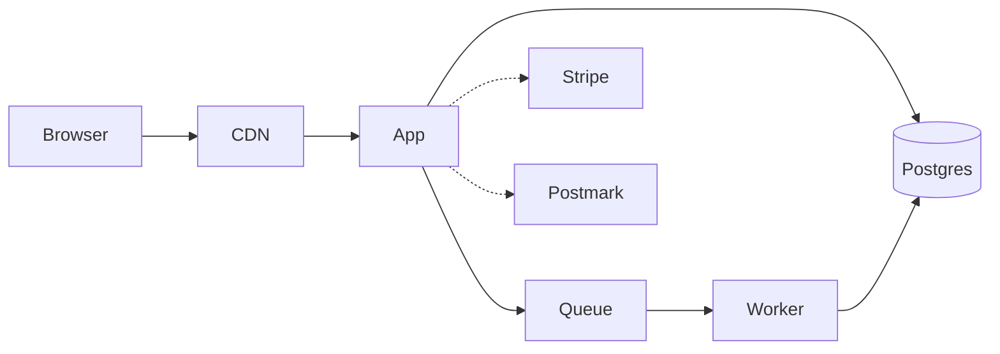

# Documentation

Write the documents people read. Skip the rest — an unread document costs
maintenance and creates false confidence.

**The test for any document:** who reads this, when, and what decision do they
make with it? If you cannot answer, do not write it.

---

## What to write, and what will go wrong with it

| Document | Read by | When | Decays because |
|---|---|---|---|
| **README** | Every new person | Day one | Setup changes and nobody re-runs it |
| **ADR** | Anyone questioning a decision | Months later | (It should not — an ADR is a historical record) |
| **Runbook** | On-call, at 3am | During an incident | Written once, never executed |
| **API reference** | Integrators | Continuously | Hand-maintained, so it drifts |
| **CLAUDE.md / AGENTS.md** | Humans and AI assistants | Every change | Conventions evolve and it is not updated |
| **Architecture overview** | New engineers, reviewers | Onboarding, big changes | Describes an architecture that was replaced |
| Comprehensive wiki | Nobody | Never | It was never true |

**The rule:** documentation that is neither *generated* nor *exercised* decays.
Generate API docs from code. Exercise runbooks in drills. Make the README's
commands the ones CI actually runs.

---

## README

The 15-minute test: hand it to someone who has never seen the project and time
them. If they are not running it in 15 minutes, the README is wrong — not the
person.

Structure (full template in `project-blueprint/templates/readme-skeleton.md`):

```
1. What this is and who it is for   — one sentence, not "a web app built with X"
2. Quick start                       — prerequisites, clone, configure, one command
3. Verify it works                   — the command that proves the setup is right
4. Commands                          — dev, test, lint, migrate, build, deploy
5. Architecture                       — a diagram or five lines of prose
6. Configuration                      — pointer to .env.example
7. Testing                            — what runs where
8. Deployment                         — environments, how, how to roll back
9. Operations                         — dashboards, logs, runbooks, on-call
10. Contributing                      — link
11. Licence
```

**The failure modes**
- A step that says "you may need to..." — that step is a bug.
- Prerequisites without versions.
- A setup that only works if you already have something installed from another
  project.
- Commands that were renamed six months ago.

**Keep it honest:** if your CI runs `npm run verify` and the README says
`npm test`, one of them is wrong. Make the README's commands the real ones.

---

## Architecture Decision Records

The highest value per word of anything in this document. One page for every
decision that is expensive to reverse.

**Write one when:** choosing a database, framework, hosting platform, auth
provider or payment provider; deciding the tenancy model or primary key
strategy; splitting or merging services; adopting or dropping a significant
dependency; establishing a pattern the codebase will follow everywhere.

**Do not write one for:** reversible choices, library upgrades, or anything you
would happily change next month.

```markdown
# ADR-0007: Use UUIDv7 for public identifiers

Status: Accepted · Date: 2026-08-24 · Reversibility: One-way door

## Context
Sequential integer ids expose business volume (/orders/1043 reveals order count
to any competitor) and enable enumeration of other users' resources. We expect
external API consumers within six months, at which point the id format becomes
a public contract.

## Options
A. bigserial — compact, index-friendly; leaks volume; enumerable
B. UUIDv4 — unguessable; random ordering hurts index locality at scale
C. UUIDv7 — unguessable AND time-ordered; 16 bytes; needs a library

## Decision
UUIDv7 as the primary key for all publicly-exposed entities.

## Consequences
+ No enumeration; no volume disclosure; mergeable across environments
+ Time-ordered, so index locality is preserved unlike UUIDv4
− 16 bytes instead of 8; larger indexes
− Requires a generation library and a database extension
− Reversing this after external consumers exist is a breaking API change

## How we would know this was wrong
If index size becomes a measured bottleneck at our data volume — revisit with
an internal bigint key plus an external UUID.
```

**Never edit an accepted ADR to change its decision.** Write a new one that
supersedes it and update the old one's status. The record of what was decided
and later reversed is more valuable than a tidy directory.

Keep them in `docs/adr/`, numbered sequentially, in version control next to the
code they constrain.

---

## Runbooks

Written for someone who did not build the system, at 3am, under stress.

```
Symptoms         How you know it is this — and how you know it is NOT the
                 similar-looking failure
Impact           Who is affected and how
MITIGATION       Copy-pasteable commands. RESTORE SERVICE BEFORE DIAGNOSING
Diagnosis        Only after mitigation, or if mitigation failed
Resolution       The real fix
Verification     The metric that proves recovery — not a hopeful refresh
Rollback         With the date it was last actually executed
Access needed    And who to wake if you do not have it
Escalation       When, who, how
```

**A runbook that has never been executed is a draft.** Run it in a drill. Every
one reveals a wrong command, a decommissioned tool, a missing credential, or a
person who left. Full template in
`release-readiness/templates/runbook.md`.

---

## API documentation

**Generate it from the code.** A hand-maintained OpenAPI spec is wrong within a
month, and a wrong spec is worse than none because people trust it.

Then contract-test real responses against the schema in CI, so the documentation
is enforced rather than aspirational.

Beyond the reference: authentication setup, rate limits, pagination,
idempotency, error catalogue with every stable code, webhook signature
verification, a sandbox, and a changelog. The reference tells an integrator what
exists; those tell them how to build against it.

---

## `CLAUDE.md` / `AGENTS.md`

Now that AI assistance is routine, this file has become one of the
highest-leverage documents in a repository. It is what makes generated code
match the codebase instead of fighting it.

```markdown
# Project conventions

## Stack
Next.js 15 (app router) · TypeScript strict · Postgres 16 + Prisma ·
Tailwind · Vitest + Playwright

## Commands
pnpm dev · pnpm test · pnpm typecheck · pnpm lint · pnpm migrate

## Structure
src/features/<domain>/    everything for one domain: routes, logic, data access
src/platform/             config, logging, db, auth, errors
Business logic goes in features/*/domain.ts — never in a route handler.

## Non-negotiables
- Config only via src/platform/config.ts. Never process.env elsewhere.
- Every route declares an authorization policy. Deny by default.
- Every DB query in a multi-tenant table filters by organizationId.
- Money is integer cents. Timestamps are timestamptz in UTC.
- Every bug fix ships with a test that fails without the fix.
- No secrets in the repo. No personal data in logs.

## Patterns to follow
- New endpoint: copy src/features/invoices/routes.ts — it shows the full shape
  (validation → authz → domain → response → test).
- New migration: prisma migrate dev, then review the generated SQL for locks.

## Do not
- Add a dependency without checking maintenance and weight
- Use `any` without a comment explaining why
- Bundle a refactor with a behaviour change
```

Keep it short and current. A 2,000-line conventions file is not read by anyone,
human or otherwise.

---

## Diagrams

One good diagram replaces pages of prose. Two rules:

**Keep it in version control as text.** Mermaid, PlantUML or D2 in a markdown
file diffs in review and updates with the code. A PNG exported from a drawing
tool in 2024 is wrong and nobody can fix it.



**Draw the level that answers a question.** A diagram of every class is
unreadable and instantly stale. A diagram of the four services and where state
lives is useful for years.

---

## Maintenance

**Documentation changes in the same PR as the code.** A checklist item in the PR
template ("docs updated if behaviour changed") catches most of it.

**Give each document an owner and a review date.** Unowned documentation is
unmaintained documentation.

**Delete what is wrong.** A stale document is worse than a missing one: it
carries the authority of documentation and the accuracy of a rumour. If nobody
will update it, remove it.

**Have the newest person fix onboarding docs.** They are the only one who can
see what is missing; everyone else has forgotten what they did not know.
